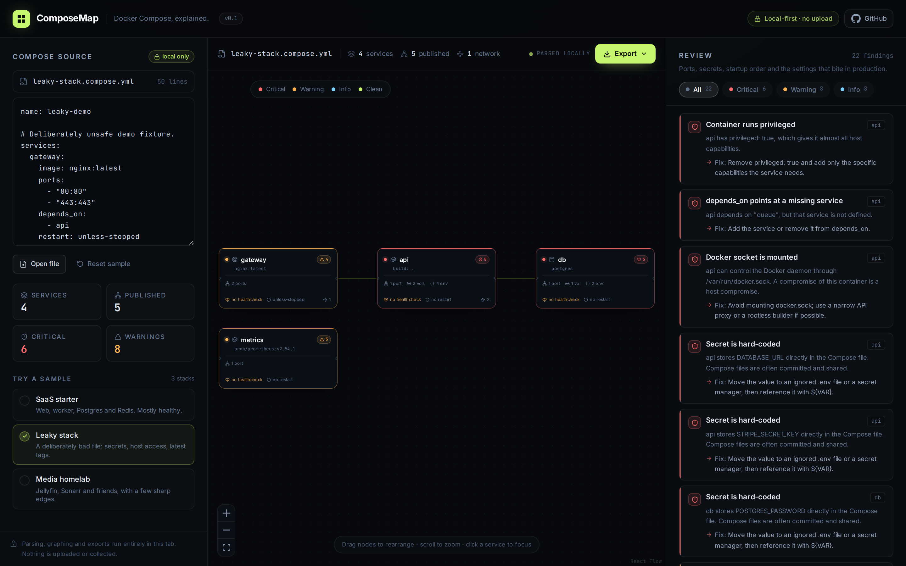

# ComposeMap

**Docker Compose, explained.** Drop in a `docker-compose.yml` and get an interactive service graph plus a plain-English review of the ports, mounts, secrets, and startup ordering that cause production surprises.

[](https://github.com/hix-pro/compose-map/actions/workflows/ci.yml)
[](LICENSE)



> The screenshot uses the bundled **Leaky stack** sample, which is intentionally unsafe. No real project data is included.

## Why

A Compose file is easy to write and hard to read back. `depends_on` hides startup order, long-form ports hide what is exposed to the host, and a literal password in `environment:` looks exactly like any other line. ComposeMap turns the file into a graph and a review so the sharp edges are visible before `docker compose up` reaches production.

Everything runs in the browser. There is no backend, no account, and no upload.

## Features

- **Service graph** — services, `depends_on` edges, and severity indicators, laid out with Dagre and rendered with React Flow.
- **Review panel** — 14 rules for images, secrets, host access, networking, healthchecks, restart policies, and dependency mistakes.
- **Service inspector** — click a node to see ports, volumes, environment **keys** (values are hidden), networks, dependencies, and that service's findings.
- **Focus and filter** — narrow the review to one service or one severity.
- **Local-only editing** — paste, drop, or open a file. It never leaves the tab.
- **Exports** — Mermaid, Markdown, SVG, PNG, and JSON. Useful for a README, a PR, or a design review.
- **Bundled examples** — a mostly healthy SaaS stack, a deliberately broken stack, and a media homelab.

## Quick start

Requires **Node.js 20+**.

```bash
npm install
npm run dev
```

Open the printed local URL. The app starts with the **Leaky stack** example; choose another sample in the left panel or open your own file.

Production build:

```bash
npm run build
npm run preview
```

Quality checks:

```bash
npm run check   # tests, typecheck, production build
npm test
npm run typecheck
```

A live demo is published at **<https://hix-pro.github.io/compose-map/>**.

## Using it

1. Paste your file into the editor, drag a `.yml`/`.yaml` file anywhere onto the page, or click **Open file**.
2. Read the graph. An edge points from a service to something it waits for.
3. Work through the review. Each finding includes a concrete fix.
4. Click a node for its full configuration summary.
5. Export a report or a Mermaid diagram for your team.

The editor remembers the last file in `localStorage` so a refresh does not lose your work. Use **Reset sample** to get back to a known fixture. Clear site data to remove the saved copy.

## What it checks

| Severity | Rule | Why it matters |
| --- | --- | --- |
| Critical | `no-image` | A service with neither `image` nor `build` cannot start. |
| Critical | `privileged` | `privileged: true` gives a container almost all host capabilities. |
| Critical | `docker-socket` | Mounting `/var/run/docker.sock` turns a container compromise into a host compromise. |
| Critical | `literal-secret` | Secret-looking values (and URLs with embedded credentials) are committed with the file. `${VAR}` references are not reported. |
| Critical | `missing-dependency` | `depends_on` points at a service that does not exist. |
| Critical | `dependency-cycle` | A cycle in `depends_on` can never reach a healthy state. |
| Warning | `latest-image` | The `latest` tag can change without a Compose change. |
| Warning | `unpinned-image` | An image with no tag resolves to `latest`. |
| Warning | `host-network` | Host networking bypasses Compose network isolation. |
| Warning | `host-network-ports` | `ports:` is ignored when `network_mode: host` is set. |
| Warning | `no-healthcheck` | A running container is not necessarily a ready one. |
| Info | `no-restart` | The service stays stopped after a crash or reboot. |
| Info | `all-interfaces` | A published port binds every host interface unless an IP is given. |
| Info | `container-name` | A fixed `container_name` prevents scaling beyond one replica. |

Rules are intentionally conservative about secrets: a value containing `${...}` is treated as a reference, not a literal. The service inspector shows environment **keys only**, so a screenshot does not leak values.

## Exports

| Format | Best for |
| --- | --- |
| Mermaid | README diagrams and docs-as-code |
| Markdown | PR descriptions and review notes |
| SVG / PNG | Slides, issues, and architecture docs |
| JSON | Scripts and further analysis |

The SVG/PNG exports are generated from the same layout as the app. The JSON schema is stable and includes the rule id, severity, service, message, and fix for every finding.

## Examples

The three files in [`examples/`](examples/) power the in-app samples:

- [`saas-starter.compose.yml`](examples/saas-starter.compose.yml) — web, worker, Postgres, Redis; mostly healthy.
- [`leaky-stack.compose.yml`](examples/leaky-stack.compose.yml) — deliberately unsafe; every major rule fires.
- [`media-homelab.compose.yml`](examples/media-homelab.compose.yml) — Jellyfin, Sonarr, qBittorrent, Watchtower.

```bash
# Drag any of these onto the app, or use Open file.
# Docker can validate the same fixtures:
docker compose -f examples/leaky-stack.compose.yml config
```

## How it works

```text
compose YAML
    │  src/lib/parse-compose.ts   normalize services, ports, volumes, env, deps
    ▼
ComposeModel
    │  src/lib/analyze.ts          rule engine with severity + fix text
    ▼
Analysis ──────────────┐
    │                  │
    │  src/lib/layout.ts│  Dagre positions for React Flow
    ▼                  ▼
Graph canvas      Review panel
    │
    └─ src/lib/export.ts           Mermaid / Markdown / SVG / PNG / JSON
```

The parser accepts short and long port/volume syntax, environment maps and lists, `env_file`, map or list `depends_on`, and disabled healthchecks. YAML is parsed with [`yaml`](https://eemeli.org/yaml/); anchors and merge keys are handled by the YAML implementation, not by custom code.

## Project layout

```text
src/
  components/       Header, source editor, graph, node card, review, export menu
  lib/
    parse-compose.ts
    analyze.ts
    layout.ts
    export.ts
    samples.ts
    *.test.ts
  App.tsx
  index.css
  main.tsx
  types.ts
examples/           Real Compose fixtures used by the app
docs/               Screenshot used by this README
.github/workflows/  CI and GitHub Pages deploy
```

## Limitations

- **Static review only.** ComposeMap does not start containers, read Docker daemon settings, resolve image contents, scan for CVEs, or inspect runtime behaviour.
- **Not a security audit.** A clean review means the configured rules found nothing, not that the stack is safe.
- **`${VAR}` is not resolved.** References are treated as references; the value in your `.env` is not inspected.
- Environment values are not shown in the UI, but the raw file still lives in the editor and in `localStorage`.
- The review targets common Compose footguns. Orchestrator-specific behaviour (Swarm, Kubernetes, ECS) is out of scope.
- Tested in current Chromium. The app needs a modern browser with ES2022 support.

## Development

```bash
npm install
npm run dev          # Vite dev server
npm test             # 34 Vitest unit tests
npm run typecheck    # strict TypeScript, no emit
npm run build        # production build
npm run check        # all of the above
```

The rule engine and exporters are pure functions with unit tests; the UI only handles state and presentation.

## Related tools

| Tool | What it does |
| --- | --- |
| [EnvAudit](https://github.com/hix-pro/env-audit) | find missing, undocumented, and unused environment variables |
| [Migration Guard](https://github.com/hix-pro/migration-guard) | statically catch dangerous SQL migrations before they run |
| [API Watch](https://github.com/hix-pro/api-watch) | catch breaking changes in your OpenAPI and JSON contracts |
| [RepoRace](https://github.com/hix-pro/reporace) | see which GitHub repositories are accelerating |
| [TypeShift](https://github.com/hix-pro/typeshift) | decide the semver bump from a TypeScript declaration diff |
| [ActionLens](https://github.com/hix-pro/action-lens) | see what a GitHub Actions workflow really does, before it hits main |
| [OpenCode Telegram](https://github.com/hix-pro/opencode-telegram) | control a local OpenCode server from Telegram |
---

_Part of the **[hix tools](https://github.com/hix-pro#readme)** suite — local-first, no backend, CI-ready._

## License

[MIT](LICENSE) © hix-pro

Fonts are self-hosted: [Inter](https://rsms.me/inter/) and [JetBrains Mono](https://www.jetbrains.com/lp/mono/) under the SIL Open Font License. See [THIRD_PARTY_NOTICES.md](THIRD_PARTY_NOTICES.md).
